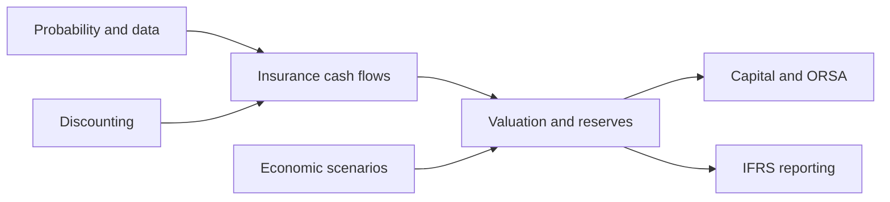

# Actuarial Refresher — 10 Hours

> Start here. This route reconnects mathematical basics, insurance cash flows, valuation, capital, and reporting. The times total 10 hours, including short pauses to work through the questions.

## The map

Use the linked notes in order. Each block has one question to answer from memory before moving on. Follow deeper links only if a concept is unclear; the full vault is larger than this route.

| Block | Time | Read in order | Check from memory |
|---|---:|---|---|
| 1. Probability basics | 50 min | [[Probability]] → [[Probability Distributions]] | Why can two portfolios have the same expected loss but different capital needs? |
| 2. Discounting | 55 min | [[Time Value of Money]] → the present-value section of [[Life Insurance Math]] | What changes when a €100 benefit moves from year 1 to year 10? |
| 3. Data and assumptions | 55 min | [[Statistics]] → [[Statistical Estimation]] → [[Correlation and Dependence]] | What is the difference between claim variation and uncertainty in an estimated claim rate? |
| 4. Life insurance | 70 min | [[Life Insurance]] → [[Survival Models and Life Tables]] → [[Life Insurance Math]] | How do mortality, discounting, and benefit timing determine a term assurance's value? |
| 5. Motor insurance | 65 min | [[Motor Insurance]] → [[Motor Insurance Math]] → [[Insurance Pricing and GLMs]] → [[Claims Reserving]] | Why are next year's new claims and this year's unsettled claims different valuation problems? |
| 6. Health insurance | 45 min | [[Health Insurance]] → [[Health Insurance Math]] | When does health modelling look more like life insurance, and when more like non-life? |
| 7. Economic scenarios | 70 min | [[Economic Scenario Generator]] → [[Real-World Scenarios]] → [[Risk-Neutral Scenarios]] | Which measure would you use for future capital outcomes, and which for valuing a financial guarantee? |
| 8. Solvency and risk | 80 min | [[Solvency II]] → [[Solvency II - Pillar I - Quantitative Requirements]] → [[Risk Measures and Diversification]] → [[Solvency II - Pillar II - Governance and Risk Management]] → [[ORSA]] | How can a solvent insurer today still have a poor ORSA outlook? |
| 9. Accounting and communication | 55 min | [[IFRS]] → [[Solvency II - Pillar III - Reporting and Disclosure]] | Why can IFRS equity differ from Solvency II own funds for the same insurer? |
| 10. Reconnect everything | 55 min | Revisit the notes needed for the case below | Trace one assumption from data to a cash flow, a liability value, capital, and a reported figure. |

**Total: 600 minutes = 10 hours.** A two-day split after block 5 is natural.

## Final case: connect the pieces

An insurer sells a life product with a guaranteed minimum return. Market interest rates fall, while policyholders live longer than expected.

1. What happens to expected benefit payments and their discounted value?
2. Which assumptions come from mortality data, and which from an economic scenario generator?
3. Why might risk-neutral and real-world scenarios both be needed?
4. Where do the changes appear under Solvency II, ORSA, and IFRS 17?

**Check your reasoning:** Longer survival can increase annuity-like payments; lower discount rates can raise the present value of future liabilities, depending on the product's cash flows. Mortality estimates and improvements come from biometric experience and judgement. An economic scenario generator supplies interest-rate and other financial paths. Risk-neutral scenarios support market-consistent valuation of the guarantee; real-world scenarios support future risk and planning analysis. Solvency II reflects valuation and capital effects, ORSA asks whether the business plan remains resilient, and IFRS 17 reports insurance liabilities and profit emergence under its own measurement rules. Product design and the precise accounting model matter.

## After the ten hours

For a deeper quantitative route, follow [[Mathematics Refresher]] into [[Stochastic Processes]], [[Stochastic Calculus]], [[Monte Carlo Simulation]], and [[Financial Models]]. For a practice route, choose a branch in [[Insurance Types]] and trace its assumptions through pricing, reserving, Solvency II, and IFRS.

## Why these topics

The [IFoA actuarial mathematics curriculum](https://actuaries.org.uk/qualify/curriculum/actuarial-mathematics) places interest theory and contingent cash flows in core actuarial modelling, and risk measures and non-life reserving in economic modelling. This route selects those connections for a refresher rather than following an exam syllabus in full.
